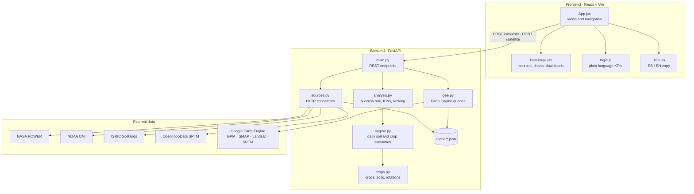

# CambaFarm

**Earn money in winter.** CambaFarm shows soybean farmers in Santa Cruz, Bolivia, what would have happened on their own field over the last 45 winters if they had planted a winter crop instead of leaving the land bare (fallow), using NASA Earth observation data.

> Built for the NASA Space Apps Challenge 2026: *Field Shift: Adapting Farms with NASA Data*.

---

## The problem

After the summer soybean harvest, most fields in the Santa Cruz lowlands stay bare for months. That fallow period:

- earns nothing,
- leaves the soil exposed to erosion and losing organic matter,
- keeps pests and diseases cycling on a single crop.

Farmers know winter crops exist (wheat, sorghum, sunflower, cover crops), but they lack a simple way to see **how often each one would have worked on their own field** and **how much it would have paid**.

## What CambaFarm does

1. **Mark your field** on a satellite map (a pin or a drawn polygon).
2. **Tell us what you do in winter today** (rest, wheat, sorghum, sunflower or cover crop).
3. **See 45 winters replayed.** The engine runs every season since 1981 with the field's real daily climate for each rotation and compares it to what the farmer does today.

The answer is given in plain words, led by one credible KPI:

> **"Sorghum would have gone well in 44 of 45 winters on your field."**

- **Success rate:** how many of the last 45 winters the crop would have gone well (see [the success rule](#the-success-kpi));
- the main reason when it fails (lack of water, frost, heat, soil too dry to sow, soy harvested late);
- how many months a year the soil stays bare, before and after;
- what happened in past years with the same El Niño / La Niña phase as the coming season;
- whether the summer soybean is affected;
- other options with their own success rate and a short label (*Recommended*, *The safest*, *Cares for your soil*);
- a priority switch: *A bit of everything*, *Less risk* or *Care for the soil*;
- an **optional** earnings estimate that uses the farmer's own yield, price and cost — never made-up numbers.

A **Data** page shows every source behind the answer, with charts, tables and CSV / JSON downloads, plus the exact rules used to decide whether a winter went well.

## The success KPI

Money depends on prices, yields and costs that change every year and that each farmer knows better than any model. So CambaFarm ranks options with a KPI built only from **measured climate and published agronomic rules**.

A winter counts as **good** only if all three conditions are met:

| Condition | Threshold | Data |
|---|---|---|
| **Could be sown** | Soy harvested in time and enough topsoil moisture inside the crop's sowing window | NASA POWER rain + soil water balance |
| **Enough water** | (rain during the cycle + plant-available water stored at sowing) ≥ 80 % of the crop's water need (FAO-56, Kc × ET0) | NASA POWER + FAO-56 |
| **No frost or heat at flowering** | No frost during flowering or grain fill, and at most 2 days above the crop's heat limit during flowering | NASA POWER daily min / max temperature |

The rate changes a lot by location, which is what makes it useful. With the same crops and rules:

| Location | Sorghum | Wheat | Sunflower | Cover crop |
|---|---|---|---|---|
| North (humid), −17.40, −63.20 | 44 / 45 | 40 / 45 | 43 / 45 | 45 / 45 |
| Chaco (dry), −19.80, −63.20, sandy loam | 13 / 45 | 17 / 45 | 26 / 45 | 25 / 45 |

The optional earnings estimate is `(good winters ÷ total) × yield × price − (sown winters ÷ total) × cost`, with the farmer's own numbers. A failed winter counts as zero harvest.

## Data sources

| Source | Provider | Used for |
|---|---|---|
| **NASA POWER** (daily, AG community) | NASA | 45 years of daily rain, temperature, wind, humidity and solar radiation that drive the crop simulation |
| **GPM IMERG** monthly (`NASA/GPM_L3/IMERG_MONTHLY_V07`) | NASA / JAXA | Satellite rainfall on the field |
| **SMAP L4** (`NASA/SMAP/SPL4SMGP/008`) | NASA | Current surface soil moisture vs. normal |
| **Landsat 8/9** C2 L2 | NASA / USGS | Field greenness (NDVI) and months with bare soil |
| **SRTM** 30 m | NASA | Elevation and slope |
| **SoilGrids 2.0** | ISRIC | Soil texture and organic carbon (0–30 cm) |
| **Oceanic Niño Index** | NOAA CPC | El Niño / La Niña phase |
| FAO-56 / FAO-33 | FAO | Crop water use and yield response coefficients |

GPM, SMAP, Landsat and SRTM slope are read through Google Earth Engine.

## How the engine works

For each rotation and each season since 1981, the engine runs these steps:

1. **Reference evapotranspiration:** the Hargreaves equation, using the daily NASA POWER weather corrected to the field's elevation.
2. **Soil water:** a two-layer bucket model, with water-holding capacity and infiltration set by the soil texture.
3. **Crop growth:** sowing happens when the topsoil is moist enough, and crop stages follow growing degree days.
4. **Yield:** water stress uses FAO-56 Ks and FAO-33 Ky. Heat and frost at flowering reduce it further.
5. **Soil cover and erosion:** canopy and residue cover are tracked day by day to count bare-soil days and estimate erosion exposure.
6. **Success rule:** each winter is classified as good or failed, with its main cause (see [The success KPI](#the-success-kpi)).

The six rotations compared are:

| Code | Rotation |
|---|---|
| A | soy → fallow (typical today) |
| B | soy → wheat |
| C | soy → sorghum |
| D | soy → sunflower |
| E | soy → cover crop |
| F | soy → wheat / maize → cover crop (2 years) |

## Architecture

CambaFarm is a two-layer web app with no database: a React frontend and a FastAPI backend that fetches public data, runs the simulation and serves the built frontend from a single process. Full details, sequence and deployment diagrams are in [`docs/arquitectura.md`](docs/arquitectura.md).



**Request flow.** `POST /simulate` loads the field's climate, soil and terrain (from cache when possible), simulates the 6 rotations over 45 campaigns, applies the success rule and returns the ranking (~1 s when cached). The frontend shows the answer right away and then calls `POST /satellite` in the background for GPM, SMAP and Landsat evidence.

## Running it locally

**Requirements:** Python 3.11+ and Node.js 18+.

### Backend (FastAPI)

```bash
cd backend
python -m venv .venv
.venv/Scripts/activate          # Windows
# source .venv/bin/activate     # macOS / Linux
pip install -r requirements.txt
```

Create `backend/.env`:

```
EE_PROJECT=your-google-cloud-project-id
```

Authorize Earth Engine once. This is optional: without it the app still works, but the satellite cards show as offline.

```bash
earthengine authenticate
```

### Frontend (React + Vite)

```bash
cd frontend
npm install
npm run build        # builds into frontend/dist, served by the backend
```

### Start

```bash
cd backend
python -m uvicorn app.main:app --host 127.0.0.1 --port 8010
```

Open <http://127.0.0.1:8010>.

For frontend development with hot reload, run `npm run dev` inside `frontend/`. API calls go through `/api` and are proxied to port 8010.

## API

| Method | Path | Description |
|---|---|---|
| `GET` | `/health` | Service and Earth Engine status |
| `GET` | `/options?lang=es\|en` | Crops, rotations and soil types |
| `POST` | `/simulate` | Runs the 45-season comparison for a point or polygon. Returns rankings, success KPIs per season (`kpi`, `winter_outcome`), the success `rules`, El Niño outlook and a `data` block with the raw inputs used |
| `POST` | `/satellite` | GPM, SMAP, Landsat and SRTM summaries for the field (each block fails independently) |

Example:

```bash
curl -X POST http://127.0.0.1:8010/simulate \
  -H "Content-Type: application/json" \
  -d '{"lat": -17.40, "lon": -63.20, "current": "A", "lang": "en"}'
```

No database is used. API responses are cached as JSON files in `backend/cache/`.

## Project structure

```
backend/
  app/
    main.py       API endpoints
    sources.py    NASA POWER, NOAA ONI, SoilGrids, elevation connectors
    gee.py        Earth Engine: GPM IMERG, SMAP, Landsat NDVI, SRTM
    engine.py     Daily crop and soil water simulation
    crops.py      Crop, soil and rotation parameters
    analysis.py   Indicators, scoring and explanations
frontend/
  src/
    App.jsx       Screens: home, field, loading, result
    DataPage.jsx  Data sources page with charts and downloads
    logic.js      Turns engine output into plain-language facts
    i18n.jsx      Spanish / English copy
docs/             Architecture (arquitectura.md), screen spec and design mockups
```

## Branches

| Branch | Content |
|---|---|
| `main` / `web` | Current version (desktop-first web layout + Data page) |
| `v1-movil` | First version with a phone-style layout |

## Limitations

- Crop parameters come from FAO references and general literature and still need calibration with local data (ANAPO, CAO, CIAT). In the humid north almost every winter crop succeeds; differences show up in drier areas.
- The success rule does not account for diseases, pests or weeds.
- NASA POWER climate represents a ~50 km cell, so a specific field can be wetter or drier.
- Nitrogen, pests and organic matter are estimated with agronomic rules, not field measurements.
- CambaFarm is a decision-support tool. It does not replace the farmer's judgment or local agronomists.

## Languages

The interface is available in **Spanish** (default) and **English**.
