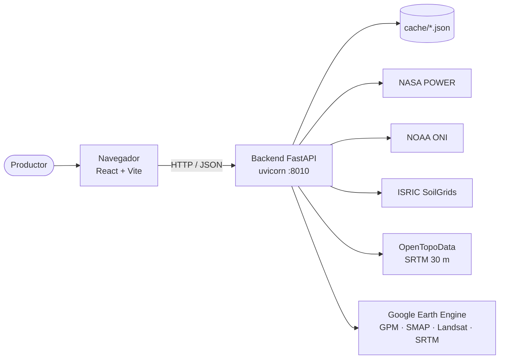
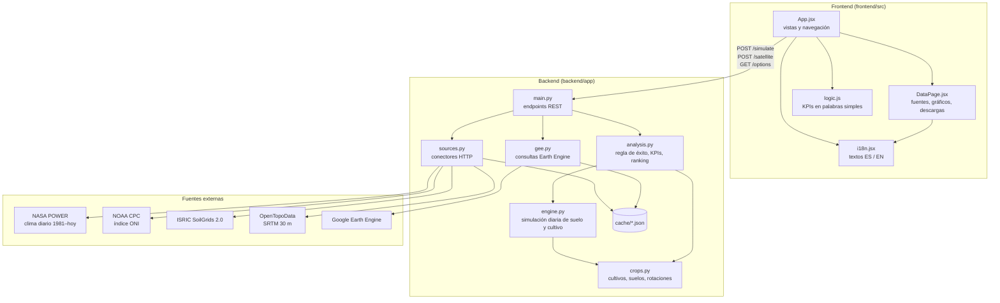
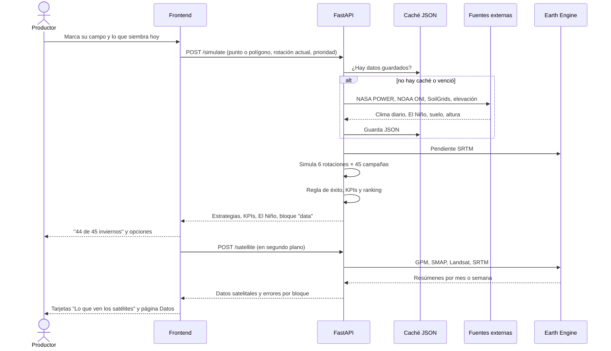
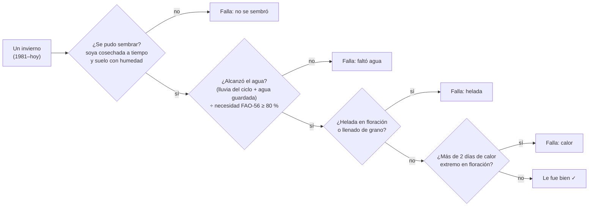
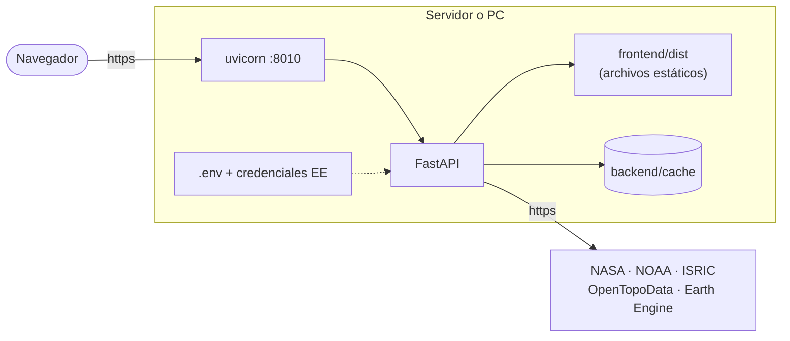

# Arquitectura de CambaFarm

Este documento describe cómo está construido CambaFarm: sus componentes, cómo viajan los datos, cómo se calcula el KPI de éxito y cómo se despliega.

## 1. Vista general

CambaFarm es una aplicación web de **dos capas**:

- **Frontend:** React 18 + Vite. Una sola página con cuatro vistas: Inicio, Mi campo, Resultado y Datos.
- **Backend:** Python + FastAPI. Trae los datos, corre la simulación y calcula los KPIs.

No usa base de datos. Las respuestas de las fuentes externas se guardan como archivos JSON en `backend/cache/`. El backend también sirve el frontend ya compilado (`frontend/dist`), así que en producción **todo corre en un solo proceso**.



## 2. Diagrama de componentes



### Responsabilidades

| Componente | Archivo | Qué hace |
|---|---|---|
| Vistas | `frontend/src/App.jsx` | Inicio, mapa del campo, pantalla de carga y resultado. Llama a la API. |
| Página de datos | `frontend/src/DataPage.jsx` | Muestra cada fuente con su dataset, estado, gráfico, tabla y descarga CSV/JSON. |
| Lógica de presentación | `frontend/src/logic.js` | Convierte la respuesta del motor en frases: "44 de 45 inviernos", meses de suelo desnudo, etiquetas de cada opción, cálculo opcional de ganancia. |
| Textos | `frontend/src/i18n.jsx` | Todo el texto visible en español e inglés. |
| API | `backend/app/main.py` | Endpoints, validación (Pydantic), orquestación y bloque `data` con los insumos crudos. |
| Conectores | `backend/app/sources.py` | NASA POWER, NOAA ONI, SoilGrids, elevación. Caché con respaldo: si la fuente falla, usa la última copia. |
| Earth Engine | `backend/app/gee.py` | GPM IMERG, SMAP L4, Landsat 8/9 NDVI y pendiente SRTM. Cada consulta falla por separado. |
| Motor | `backend/app/engine.py` | Simulación día a día: ET0 Hargreaves, balance de agua en dos capas, fenología por grados-día, estrés hídrico FAO-56, rinde FAO-33, heladas y calor, cobertura y erosión. |
| Análisis | `backend/app/analysis.py` | Regla de éxito por invierno, KPIs por estrategia, ranking por prioridades, fichas de riesgos. |
| Parámetros | `backend/app/crops.py` | Cultivos (Kc, Ky, raíz, umbrales de calor y helada, ventanas de siembra), suelos y las 6 rotaciones. |

## 3. Flujo de una consulta



La simulación responde en ~1 segundo con caché. La primera consulta de un campo nuevo tarda más (SoilGrids ~10 s y Earth Engine ~20 s), por eso los satélites se piden **después** de mostrar el resultado.

## 4. Cómo se calcula el KPI de éxito

El titular de la app es **"X de N inviernos le habría ido bien en tu campo"**. No usa precios ni rindes inventados.



| Condición | Umbral | Datos |
|---|---|---|
| Se pudo sembrar | Humedad del suelo superficial ≥ umbral del cultivo dentro de su ventana de siembra, y cultivo anterior ya cosechado | NASA POWER + balance de agua |
| Alcanzó el agua | (lluvia del ciclo + agua útil en la zona de raíces al sembrar) ≥ 80 % de la evapotranspiración del cultivo (Kc × ET0) | NASA POWER + FAO-56 |
| Sin helada | Ninguna temperatura mínima bajo el umbral del cultivo en floración o llenado | NASA POWER |
| Sin calor | No más de 2 días sobre la máxima tolerada en floración | NASA POWER |

Los umbrales están en `backend/app/analysis.py` (`WATER_OK`, `HEAT_DAYS_MAX`) y la API los devuelve en `rules`, para que la página Datos los muestre.

**Ranking de opciones.** Se combina por prioridad del productor:

| Prioridad | Éxito de invierno | Soya de verano | Suelo | Plagas |
|---|---|---|---|---|
| De todo un poco | 45 % | 20 % | 25 % | 10 % |
| Menos riesgo | 65 % | 30 % | 5 % | — |
| Cuidar el suelo | 30 % | 10 % | 60 % | — |

"Suelo" combina días de suelo desnudo, exposición a erosión y rastrojo.

**Ganancia (opcional).** Solo aparece si el productor escribe sus números:

```
ganancia ≈ (inviernos buenos ÷ total) × rinde × precio − (inviernos sembrados ÷ total) × costo
```

Un invierno que falla cuenta como cosecha cero (estimación prudente).

## 5. Datos y caché

| Fuente | Acceso | Caché |
|---|---|---|
| NASA POWER (diario, comunidad AG) | REST, sin clave | 30 días |
| NOAA CPC ONI | Archivo de texto, sin clave | 7 días |
| ISRIC SoilGrids 2.0 | REST, sin clave | 365 días (si falla, reintenta en 30 min) |
| OpenTopoData SRTM 30 m | REST, sin clave | 10 años |
| GPM IMERG mensual | Earth Engine | 20 días |
| SMAP L4 humedad superficial | Earth Engine | 3 días |
| Landsat 8/9 NDVI | Earth Engine | 15 días |
| SRTM pendiente | Earth Engine | 10 años |

Si una fuente no responde, el backend usa la última copia guardada. Si nunca hubo copia, la parte afectada se marca como "Sin conexión" o "Valor por defecto" y el resto de la app sigue funcionando.

## 6. Configuración y despliegue

| Variable / acceso | Dónde | Para qué |
|---|---|---|
| `EE_PROJECT` | `backend/.env` | Proyecto de Google Cloud registrado en Earth Engine |
| Autorización de Earth Engine | `earthengine authenticate` (local) o cuenta de servicio (`GOOGLE_APPLICATION_CREDENTIALS`) en un servidor | Consultas satelitales |



Pasos: `npm run build` en `frontend/`, luego `uvicorn app.main:app --port 8010` en `backend/`. Para desarrollo, `npm run dev` levanta Vite con proxy `/api` → `:8010`.

## 7. Limitaciones conocidas

- Los parámetros de cultivo vienen de referencias FAO y literatura general; falta calibrarlos con datos locales (ANAPO, CAO, CIAT).
- El clima de NASA POWER representa una celda de ~50 km.
- La regla de éxito no considera enfermedades, plagas ni malezas.
- En la zona norte húmeda casi todos los cultivos de invierno salen bien; las diferencias aparecen en zonas más secas (este y Chaco).
